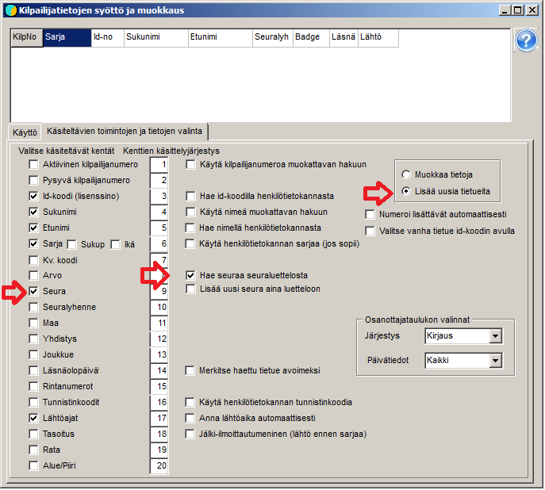

# Manuell inmatning av anmälningar

Ofta måste enskilda anmälningar läggas till genom att uppgifterna knappas in
en deltagare i taget. Detta sker på formuläret *Inmatning och redigering av tävlandes
uppgifter,* som du når via valet *Deltagare /
Anmälningar.*

Formuläret kan öppnas så att texten
*Redigeringsläge* visas. Detta driftläge lämpar sig när
platser för vakanser har skapats i förväg bland de tävlandes uppgifter och dessa redigeras
till deltagare. Om du vill lägga till nya poster måste du ta i bruk
*Tilläggsläge.* Läget byts på undersidan *Val av funktioner och
uppgifter att behandla*, där du också kan välja vilka fält som går att
behandla samt om programmet vid inmatningen använder en förteckning över möjliga
deltagare eller en klubblista som hjälp. (Det finns också några andra
valmöjligheter.)

När formuläret används för inmatning av anmälningar före
lottningen behöver du inte ange startnummer eller starttid. Valet av klass
är nödvändigt för programmets funktion, övriga uppgifter matas in efter
behov. Klubblistan hjälper till att få klubbförkortningarna felfria och
att få med de långa klubbnamnen redan i detta skede. När du kryssar i *Sök klubb
i klubblistan* öppnas klubblisteformuläret, där du ska välja
den klubblista Seurat.csv som ska öppnas och användas. När du sedan matar in klubbförkortningen och trycker Enter när valet
har träffat rätt ställe i klubblistan, förs även det långa klubbnamnet och
distriktskoden över, även om de inte har valts att visas
på anmälningsformuläret.

Tabellen i formulärets övre del har i huvudsak till uppgift att visa
den senast sparade uppgiften, som kan hämtas tillbaka därifrån för korrigering när
*Redigera uppgifter* har valts som driftläge.
