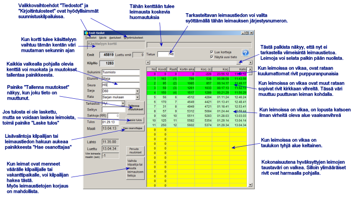
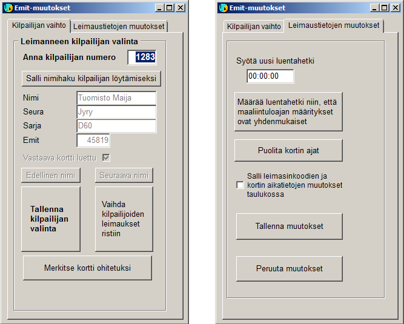

# Punch checking

When you select *Results service /
Emit reading* from the main menu, this form opens

Here we look at the punch-checking function
in an orienteering competition. In fitness orienteering events, where the competitors are not
in the competitor data with their Emit codes in advance, the form is used in a slightly
different way. The mode of operation is affected by the program configuration and also by
the form's options *Show* and *Settings*, which are usually not
needed in orienteering competitions.

When a new card is read, the program immediately shows its data,
provided that the form is showing the latest data and the checkboxes are
ticked, as above. In the example the data would not be shown immediately,
because an earlier record is being viewed, but a button would appear
to the right of the field showing the record number; clicking it takes you
to the new data.

When all data is in order, you do not need to do anything
on the form; the next card can be read immediately. The area in the top left
corner that changes its background colour helps you notice that a new card has been
read when the data otherwise changes very little.

When a card whose code does not belong
to any competitor is read, another form opens:

The same form can also be opened with a button
on the form *Emit data*.

Both tabs of the change form are shown above.
The left one is needed more often; it is used to select the competitor to whom the punches
belong when they have been recorded for the wrong competitor or for a
vacancy record. If the correct competitor's number is known, just
enter it and confirm by pressing Enter twice. The program should then
also perform the appropriate punch check and calculate the result, unless the competitor
already has one. You must, however, check on the form *Emit data*
that this has happened, because there are situations in which the program does not
take these actions.

If the number is not known, a button takes you
to the name search, which starts by typing at least the beginning of the name and pressing
Enter. You can then search by browsing in alphabetical order. A tick in
*Corresponding card read* indicates that Emit data has already been
read for the selected competitor, which suggests that the selection is wrong or that the data of two
competitors has been swapped. In the latter case, the right-hand
confirmation button performs the necessary swap of the data.

On the other tab of the form you can change the recorded
readout time of the card and correct a situation sometimes caused by a faulty card,
in which all its time differences are doubled. Through this tab
you can also allow editing of the table on the form Emit data
for the columns *Code* and *Card time* (these two columns
show directly what has been stored on the card; the other columns are calculated or
deduced from the data in these columns).

Correcting the card readout time helps to get the split times
right when a failed first readout of the card has made them
incorrect. In a competition where the times are determined by online timing
at the finish line, matching the calculated and the actual finish time
usually gives the correct split times. When the result is determined at punch checking,
the correct finish time may also have to be estimated.
