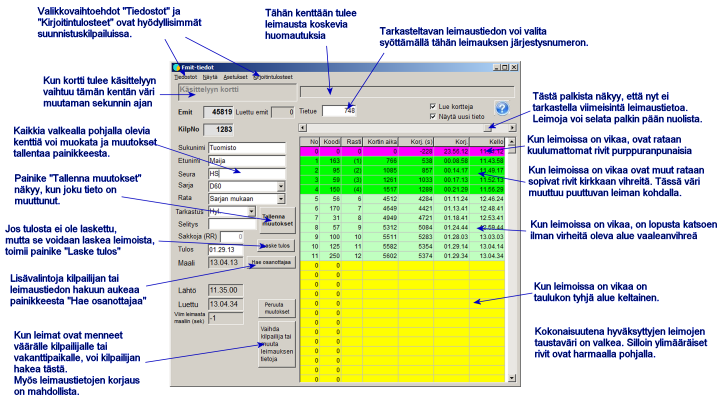
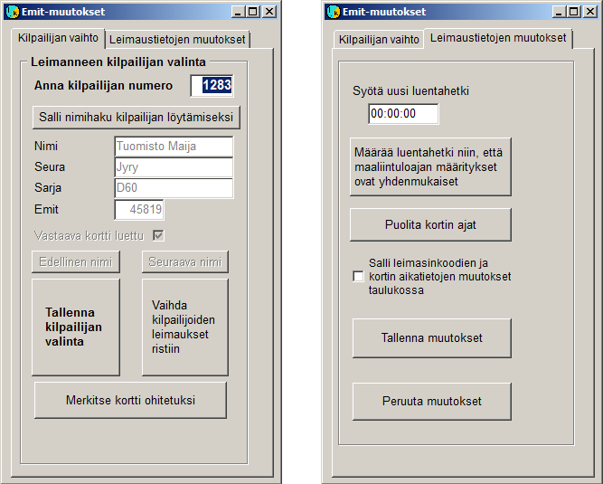

# Stämplingskontroll

När du väljer *Resultattjänst /
Emit-avläsning* i huvudmenyn öppnas detta formulär

Här granskas stämplingskontrollfunktionen
vid en orienteringstävling. Vid motionsorienteringar, där deltagarna inte
i förväg finns med sina Emit-koder i deltagaruppgifterna, används formuläret på ett något
annorlunda sätt. Arbetssättet påverkas av programmets konfigurering och även av
formulärets val *Visa* och *Inställningar*, som i allmänhet inte
behövs vid orienteringstävlingar.

När en ny bricka läses visar programmet genast dess uppgifter,
förutsatt att formuläret visar de senaste uppgifterna och kryssen är
ikryssade som ovan. I exemplet skulle uppgifterna inte visas genast,
eftersom en tidigare post granskas, men till höger om fältet som visar postnumret
skulle en knapp visas, och genom att klicka på den kommer du till behandlingen av den nya
uppgiften.

När alla uppgifter är i ordning behöver du inte göra
något på formuläret, utan nästa bricka kan läsas genast. Området i övre vänstra
hörnet som byter bakgrundsfärg hjälper dig att märka att en ny bricka har
lästs när uppgifterna i övrigt ändras mycket lite.

När en bricka vars kod inte tillhör
någon tävlande kommer till läsaren öppnas ett annat formulär:

Samma formulär kan också öppnas
med en knapp på formuläret *Emit-uppgifter*.

Ovan visas ändringsformulärets båda undersidor.
Oftare behövs den vänstra, där du väljer den deltagare som stämplingarna
tillhör, när de har registrerats på fel deltagare eller på en
vakant post. Om den rätta tävlandes nummer är känt behöver det bara
matas in och bekräftas genom att trycka Enter två gånger. Då bör programmet
också göra en korrekt stämplingskontroll och räkna ut resultatet, om den tävlande
inte redan har ett. Du måste dock kontrollera på formuläret *Emit-uppgifter*
att så har skett, eftersom det finns situationer där programmet inte vidtar åtgärderna.

Om numret inte är känt kan du via en knapp gå till
namnsökning, som börjar med att du skriver åtminstone början av namnet och trycker
Enter. Sedan kan du söka genom att bläddra i alfabetisk ordning. Ett kryss vid
*Motsvarande bricka läst* anger att Emit-uppgifter redan har
lästs för den valda tävlande, vilket tyder på att valet är fel eller att två
tävlandes uppgifter har korsats. I det senare fallet leder
den högra bekräftelseknappen till det nödvändiga bytet av uppgifterna.

På formulärets andra undersida kan du ändra brickans
registrerade avläsningstidpunkt samt korrigera en situation som ibland uppstår med en defekt
bricka, där alla dess tidsskillnader är dubbla. Via denna undersida
kan du också tillåta redigering av tabellen på formuläret Emit-uppgifter
för kolumnerna *Kod* och *Brickans tid* (dessa två kolumner
anger direkt vad som har sparats på brickan, de övriga kolumnerna räknas ut eller
härleds från uppgifterna i dessa kolumner).

Att korrigera brickans avläsningstidpunkt hjälper till att få mellantiderna
rätt när ett misslyckande vid brickans första avläsning har gjort dem
felaktiga. I en tävling där tiderna har bestämts med online-tidtagning
på mållinjen ger överensstämmelse mellan beräknad och verklig måltid
i allmänhet rätt mellantider. När resultatet har bestämts i stämplingskontrollen kan
även den rätta måltiden behöva uppskattas.
