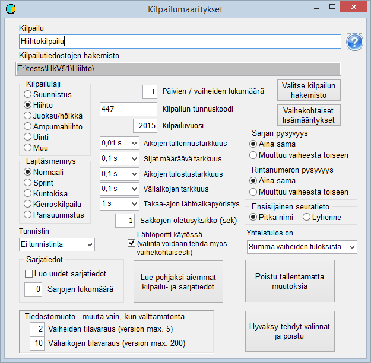

# Basic settings

When starting to set up a competition, you must decide in which
folder the competition data will be placed. My recommendation is that a new folder be
created for the competition as a subfolder of the folder Kisa created during installation. The folder
can be created with the program *HkKisaWin* at the same time as the other
basic settings are defined. Start by launching *HkKisaWin* and
clicking the button *Competition creation and basic properties*.
This opens the form *Competition settings.*

You usually save a considerable amount of effort by using
an earlier competition as a basis. In this case the class data is taken
as a basis from the sample data installed with the program by clicking
*Use earlier competition and class data as base* and opening the file
KilpSrj.xml from the folder Kisa created
when the program was installed.

Next, click *Select competition
folder* and go to the folder reserved for the competition, or create this
folder using the folder creation function of the dialog. When the selection is accepted,
the program creates an empty file ilmoitt.cfg and saves it in the selected folder.

Give the competition a suitable title and
an identification code, which can be, for example, the numeric code used in the IRMA system of
the Finnish Orienteering Federation (SSL). The other options are automatically suitable for a single-stage
orienteering competition: the Emit card is used, the timing precision is 1 s,
the abbreviation is used as the primary form of club names, as in IRMA, and the
default penalty unit is 600 s. Both the class and the bib number are
always the same, i.e. identical in the competitor's basic data and in the
only competition stage in use.

When you exit the form accepting the selections made,
the file KilpSrj.xml containing the settings is saved in the
competition folder. At the same time an empty file laskenta.cfg is created.

Once the basic properties have been selected this way, the competition
can be opened for preparation by clicking the button of that name and opening ilmoitt.cfg. The program then reports that the file KILP.DAT
does not exist
and creates it.
