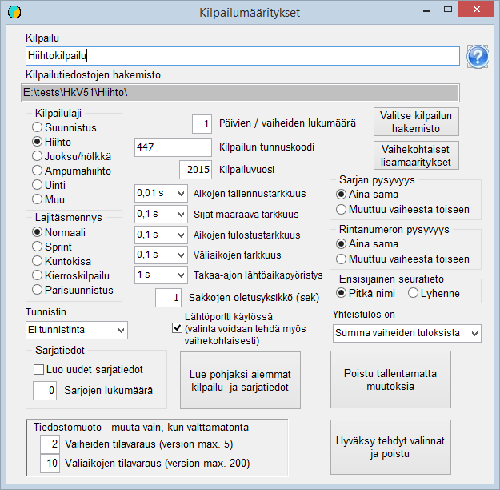

# Grundval

När du börjar skapa en tävling måste du bestämma i vilken
mapp tävlingens uppgifter ska placeras. Min rekommendation är att en ny mapp
skapas för tävlingen som undermapp till mappen Kisa som skapades vid installationen. Mappen
kan skapas med programmet *HkKisaWin* samtidigt som de övriga
grundvalen definieras. Du börjar med att starta programmet *HkKisaWin* och
klicka på knappen *Skapa tävling och grundegenskaper*.
Då öppnas formuläret *Tävlingsinställningar.*

I allmänhet sparar du avsevärt mycket besvär genom att använda
någon tidigare tävling som grund. I det här fallet hämtas
klassuppgifterna som grund från det exempelmaterial som installerats med programmet: klicka på
*Läs tidigare tävlings- och klassdata som grund* och öppna filen
KilpSrj.xml i mappen Kisa som skapades när
programmet installerades.

Klicka sedan på *Välj tävlingens
katalog* och gå till den mapp som reserverats för tävlingen, eller skapa denna
mapp med dialogfönstrets funktion för att skapa mappar. När valet godkänns
skapar programmet en tom fil ilmoitt.cfg och sparar den i den valda mappen.

Tävlingen bör ges en lämplig rubrik och en
kod, som till exempel kan vara den nummerkod som används i Finlands Orienteringsförbunds (SSL)
IRMA-system. De övriga valen passar automatiskt en orienteringstävling
med en etapp: Emit-bricka används, tidtagningsnoggrannheten är 1 s,
av klubbnamnen används i första hand förkortningen, som i IRMA, och straffens
standardenhet är 600 s. Både klass och startnummer är
alltid desamma, dvs. samma i den tävlandes grunduppgifter och i den enda
tävlingsetappen.

När du lämnar formuläret och godkänner de gjorda valen
sparas filen KilpSrj.xml med inställningarna i
tävlingens mapp. Samtidigt skapas en ännu tom fil laskenta.cfg.

När grundegenskaperna har valts på detta sätt kan tävlingen
öppnas för förberedelse genom att klicka på knappen med detta namn och öppna ilmoitt.cfg. Då meddelar programmet att filen KILP.DAT
inte finns
och skapar en sådan.
