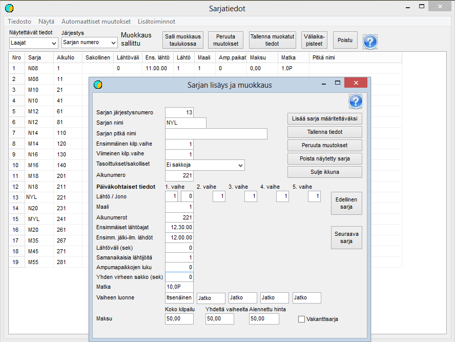

# Class data

The second phase of the basic preparation is editing the class data to meet the
requirements of the competition. You get to this phase by selecting
*Preparation / Class data* from the menu. Class data can be viewed and edited
both on this form and one class at a time on a form that opens
when you click a class in the table.

As an example, a control route class has been opened above, because it
contains options that are not correct in all base data.
For a control route class you must select, as in the picture,
*Control route penalties,* which also puts the penalty amount 600 in the field
*Penalty per error (sec).* If this number is not shown even though the selection has already been made,
clicking the words *Control route penalties* is enough, provided that the number 600 was left
as the penalty unit size when the competition was
set up. When the data
has changed, it must be saved, after which it also appears, where
applicable, in the table.

At this stage, all that matters is that all
classes that will receive entries are defined and
named exactly as in the entry data. Other data can be
refined when you move on to the draw.

In addition to the classes included in the competition, it is a good idea to define
a separate class for vacancy records. A few
predefined vacancies make it easier to handle exceptional situations when reading
Emit cards at punch checking. Such exceptional situations can arise, among other things, from incorrectly reported
Emit codes and from faulty Emit cards.

Classes can only be added and deleted on the
single-class form. To add one, start by clicking *Add class
to define.* Then fill in the necessary data and give
the class an ordinal number such that it is placed in the
correct position in the class list. When the class is then saved, the ordinal numbers of
the subsequent classes are increased.

Much other data can be edited both one class at a time
and in the table, where you can make several changes before saving them. The table is
particularly useful when defining the classes' start times and the starting values of the numbering.
We return to this in connection with the draw.
