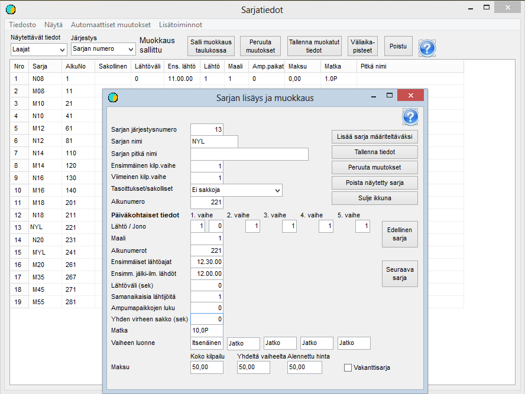

# Klassuppgifter

Det andra steget i grundförberedelsen är att anpassa klassuppgifterna till
tävlingens krav. Du kommer till detta steg genom att välja
*Förberedelse / Klassuppgifter* i menyn. Klassuppgifterna kan granskas och redigeras
både på detta formulär och klass för klass på det formulär som öppnas
när du klickar på en klass i tabellen.

Som exempel har ovan en klass med kontrollrutt (rastireitti) öppnats, eftersom den
innehåller val som inte är rätt i alla grunduppgifter.
För en klass med kontrollrutt måste du som i bilden välja
*Straff för kontrollrutt,* och då visas samtidigt straffets storlek 600 i fältet
*Straff för en etapp.* Om detta tal inte visas trots att valet redan har gjorts
räcker det att klicka på ordet *Straff för kontrollrutt*, förutsatt att talet 600
lämnades som straffenhetens storlek när tävlingen skapades. När uppgifterna
har ändrats måste de sparas, och då visas de i tillämpliga
delar även i tabellen.

I detta skede är det väsentliga bara att alla
klasser som det kommer anmälningar till har definierats och
namngetts exakt på samma sätt som i anmälningsuppgifterna. Övriga uppgifter kan
preciseras när du går vidare till lottningen.

Utöver de klasser som ingår i tävlingen är det bra att definiera
en separat klass för vakanta poster. Några
i förväg definierade vakanser underlättar hanteringen av undantagssituationer när
Emit-brickor läses i stämplingskontrollen. Sådana undantagssituationer kan uppstå bl.a. av felaktigt anmälda
Emit-koder och av defekta Emit-brickor.

Klasser kan läggas till och tas bort endast på formuläret för en
enskild klass. Tillägget börjar med ett klick på *Lägg till klass
att definiera.* Därefter fyller du i de nödvändiga uppgifterna och ger
klassen ett ordningsnummer så att den hamnar
på rätt plats i klasslistan. När klassen sedan sparas ökas
ordningsnumren för de efterföljande klasserna.

Många andra uppgifter kan redigeras både klass för klass
och i tabellen, där du kan göra flera ändringar innan de sparas. Tabellen är
särskilt användbar när klassernas starttider och numreringens startvärden fastställs.
Vi återkommer till detta i samband med lottningen.
