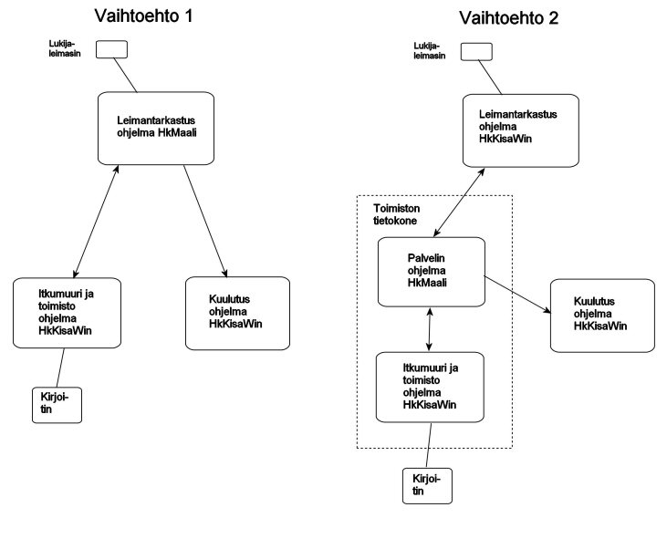

# Tasks of the computers

In a national orienteering competition, the following tasks typically
have to be handled during the competition:

- punch checking, which also produces the results
  based on the punch taken at the finish line- the complaints desk, which handles cases where
    the punches are not accepted directly- writing the results lists, which during the competition
      happens automatically soon after the standings of a class have changed- marking non-starters when information about them
        has been received from the start- separately printed results lists, for example
          for the prize giving- various corrections to competitor data- corrections to course data if it contains errors or
              some punch stops working- support for the announcer- connections between the computers, which normally works so that
                  one computer acts as a "server" to which the other computers are connected.

At least three computers are needed to handle these tasks:

1. the punch-checking computer- the computer for the complaints desk and for recording other changes,
     which also handles the other separate tasks- the announcer's computer

I recommend using the program HkMaali on at least one computer until
enough experience has been gained with HkKisaWin that its reliability
can be fully trusted. If you want to handle all the different tasks with
HkKisaWin, this requires either one additional computer or running
both programs on one computer. HkMaali then acts, among other things, as
the hub of the data transfer, i.e. the "server".

Of the functions, punch checking can be handled both with HkMaali and
with HkKisaWin. In the former case the punch-checking computer can
act as the server; in the latter, both programs can be kept running on the office computer,
one as the server and the other for carrying out
the functions for which HkKisaWin is better suited.

The user interface of
HkKisaWin is already better and is constantly developing.
Therefore I now primarily recommend option 2, and below I present
the configuration files in a form suitable for it.

