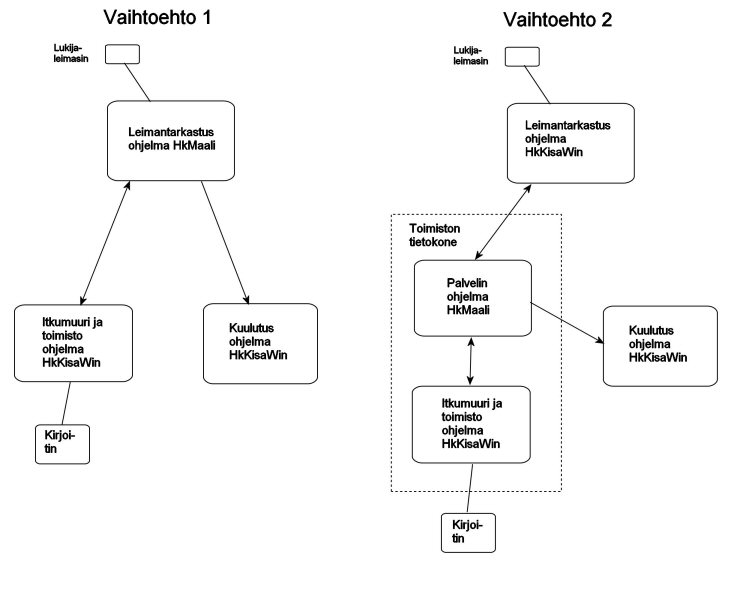

# Datorernas uppgifter

Vid en nationell orienteringstävling måste typiskt följande uppgifter
skötas under tävlingen:

- stämplingskontroll, som också ger resultaten
  utifrån stämplingen på mållinjen- klagomur, där fall behandlas där
    stämplingarna inte godkänns direkt- skrivning av resultatlistor, vilket under tävlingen
      sker automatiskt strax efter att ställningen i en klass har ändrats- markering av dem som inte startat, när uppgift om dessa
        har kommit från starten- separat utskrivna resultatlistor bl.a.
          för prisutdelningen- varierande korrigeringar av de tävlandes uppgifter- korrigeringar av banuppgifterna om de innehåller fel eller
              någon stämplingsenhet slutar fungera- stöd till speakern- förbindelser mellan de olika datorerna, vilket normalt sker så att
                  en dator fungerar som "server", som de andra datorerna är anslutna till.

För att sköta dessa uppgifter behövs minst tre datorer:

1. stämplingskontrollens dator- dator för klagomuren och registrering av övriga ändringar,
     där även övriga separata uppgifter utförs- speakerns dator

Jag rekommenderar att programmet HkMaali används på åtminstone en dator tills
man har fått så mycket erfarenhet av programmet HkKisaWin att man helt kan lita på
dess driftsäkerhet. Om man vill sköta alla de olika uppgifterna med programmet
HkKisaWin förutsätter det antingen en extra dator eller att båda programmen
används på samma dator. Programmet HKMaali fungerar då bl.a. som
nod för dataöverföringen, dvs. som "server".

Av funktionerna kan stämplingskontrollen skötas både med programmet HkMaali och
med programmet HkKisaWin. I det förstnämnda fallet kan stämplingskontrollens dator
fungera som server, i det senare kan båda programmen köras på kontorets dator,
det ena som server och det andra för att utföra de funktioner
som HkKisaWin lämpar sig bättre för.

Användargränssnittet är
redan nu bättre i programmet HkKisaWin och utvecklas ständigt.
Därför rekommenderar jag nu i första hand alternativ 2 och presenterar
längre fram konfigurationsfilerna i en form som passar för det.

