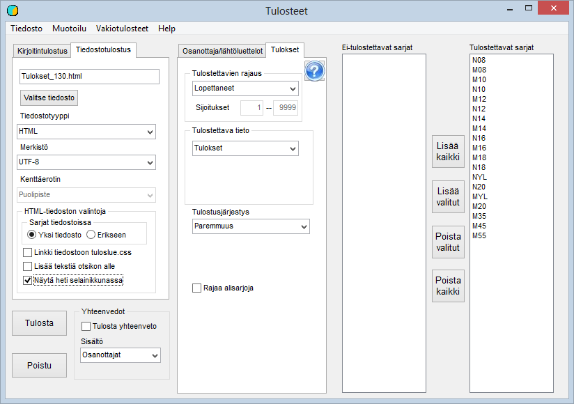

# Results lists

This form can be opened from the main menu item *Outputs*

In the example, after the form was opened,
*Standard outputs / All finishers to html file* was selected.
This selection has caused all classes to be selected for output.
The name of the output file has been determined from the code given to the competition:
*2011\_egames.*

Many other selections can be made from the drop-down
lists, and instead of a file you can print to a printer, which can be
selected from among the printers recognised by Windows on that computer.
The list of printers may also include the option to make a pdf file of the results.

The Formatting option lets you change the formatting of the
results list to be produced if the defaults are not suitable.

Note in particular that the program's default
is now to use long club names in outputs in orienteering too. If
these have not been added to the competitor data, you may need to
switch from the club name to the abbreviation in the formatting. Another option is to copy
the abbreviations into the club name field as well with the main menu function *Entries
/ Copying club names and classes.*

When only one or a few classes are to be output,
they can be selected by double-clicking the class name or by selecting the name and
using the button.

For most text files, the program's default
is UTF-8 encoding, which is becoming ever more clearly dominant. For the time being, however,
it may cause problems, which are solved by changing the character set to ISO-8859-1.
