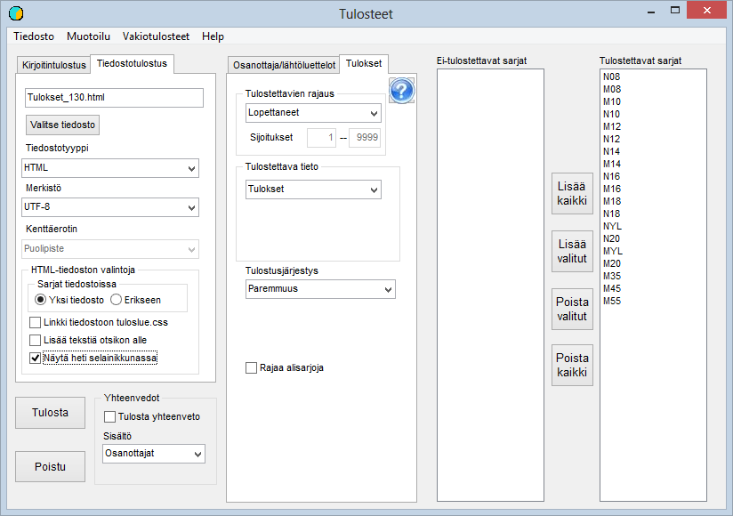

# Resultatlistor

Via valet *Utskrifter* i huvudmenyn kan
detta formulär öppnas

I exemplet har man efter att formuläret öppnats
valt *Standardutskrifter / Alla målgångna till html-fil*.
Valet har dessutom lett till att alla klasser har valts för utskrift.
Namnet på filen som skrivs ut har bestämts utifrån den kod som getts tävlingen:
*2011\_egames.*

I rullgardinsmenyerna kan du göra många andra
val, och i stället för till en fil kan du skriva ut till en skrivare, som kan
väljas bland de skrivare som Windows känner igen på datorn.
I skrivarlistan kan det också finnas möjlighet att skapa en pdf-fil av resultaten.

Via valet Formatering kan du ändra formateringen av den
resultatlista som sammanställs, om standardinställningarna inte passar.

Observera särskilt att programmets standardinställning
numera är att långa klubbnamn används i utskrifterna även i orientering. Om
dessa inte har hämtats till de tävlandes uppgifter kan det vara nödvändigt att i formateringen
byta från klubbnamn till förkortning. Ett annat alternativ är att kopiera
förkortningarna även till klubbnamnsfältet med funktionen *Deltagare
/ Kopiering av klubbnamn och klasser* i programmets huvudmeny.

När endast en eller några klasser ska skrivas ut
kan de väljas genom att dubbelklicka på klassens namn eller genom att välja namnet och
använda knappen.

För de flesta textfiler är programmets standardinställning
UTF-8-kodning, som allt tydligare håller på att bli dominerande. Tills vidare kan
den dock orsaka problem, som löses genom att byta teckenuppsättning till ISO-8859-1.
