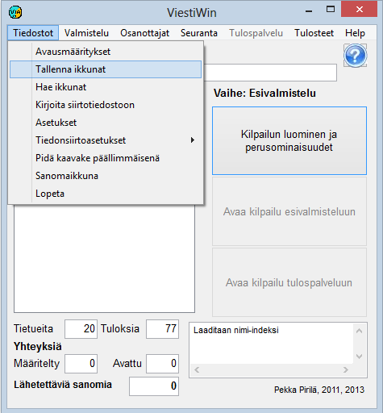

# 1.3.1 Menyval: Filer

Valet *Filer* öppnar följande
undermeny.

Via alternativen kommer du till följande funktioner:

- **Startinställningar**. Definierar hur programmet
  startar nästa gång. På så sätt kan programmet
  öppnas direkt i önskad tävling.

  - **Spara fönster.** Sparar
    de fönster som är i bruk när du sparar, vilket gör det möjligt
    att framöver öppna programmet i till stor del samma läge.

    - **Hämta fönster.** Tar i bruk
      det läge som sparats med valet *Spara fönster*.

      - **Skriv till överföringsfil.**Skriver tävlingens data
        till textfiler (csv eller xml), till en MySQL-databas eller till en aktuell kopia
        av filen KILP.DAT som används.

        - **Inställningar.** Den viktigaste funktionen är
          för närvarande möjligheten att under tävlingen läsa in filen korostus1.lst, som styr
          färgmarkeringen av VIP-deltagare (korostus2.lst osv. i flerdagarstävlingar, se kapitel 8.3).

          - **Jämförelsetider.** Definierar parametrar som styr
            analysen av Emit-mellantider.

            - **Inställningar för dataöverföring.**

              - **Inställningar och
                omstart.**Stänga och återöppna förbindelser, skicka tidigare
                skickade meddelanden på nytt.

                - **Granska överföringsfil.**
                  Granska innehållet i filen COMFILE.DAT. På så sätt kan du ta reda på
                  vad som har hänt i olika skeden av resultattjänsten.- **MySQL.** Definierar
                databasanslutningen och öppnar den eventuellt för kontinuerlig drift. En engångsöverföring
                startas med valet *Skriv till överföringsfil.*. Ännu inte genomfört i stafettprogrammet.

                - **Meddelandefönster.** Öppnar ett separat
                  fönster som innehåller samma meddelanden som fönstret i huvudformulärets nedre
                  högra hörn.

                  - **Avsluta.** Stänger programmet. (Samma
                    effekt som stängningsrutan i formulärets övre
                    högra hörn.)
