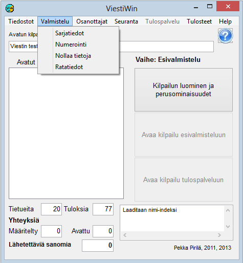

# 1.3.2 Menu: Preparation

The menu *Preparation* leads to functions that are performed
before the actual results service phase and when creating the next stage on the basis of a completed
stage, such as a final based on a qualification. Orienteering
course data can also be changed for the stage in progress.

Some of the options are disabled when the selected operating mode makes their use
impossible or undesirable.

- **Class data.** Opens a table
  for viewing and editing class definitions. From the table
  you can further open the split point definitions and a form
  for handling an individual class.

  - **Numbering.**
    The competition draw, e.g. in team orienteering, and assigning
    bib numbers to entrants.

    - **Reset data.** Resets results and
      some other data. Possible only in
      preparation mode.

      - **Course data.** Defines and edits orienteering
        course data. Editing is also possible for the data of the stage
        in progress.
