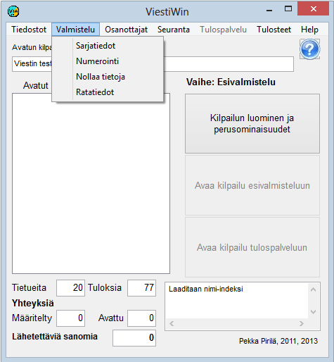

# 1.3.2 Menyval: Förberedelse

Via valet *Förberedelse* kommer du till funktioner som utförs
före själva resultattjänstfasen samt när nästa etapp skapas utifrån en avslutad etapp,
till exempel en final utifrån ett kval. Orienteringens
banuppgifter kan ändras även för en pågående etapp.

En del av valen är spärrade när det valda driftläget gör användningen av dem
omöjlig eller oönskad.

- **Klassuppgifter.** Öppnar en tabell
  för att granska och redigera klassdefinitionerna. Från den tabell som öppnas
  kan du vidare öppna definitionen av mellantidspunkter samt ett formulär för en enskild
  klass.

  - **Numrering.**
    Tävlingens lottning bland annat i patrullorientering och tilldelning av
    deltagarnas nummer.

    - **Nollställ data.** Nollställer resultat och
      vissa andra uppgifter. Endast möjligt i
      förberedelseläget.

      - **Banuppgifter.** Definiera och redigera
        orienteringens banuppgifter. Redigering är möjlig även för en pågående
        etapps uppgifter.
