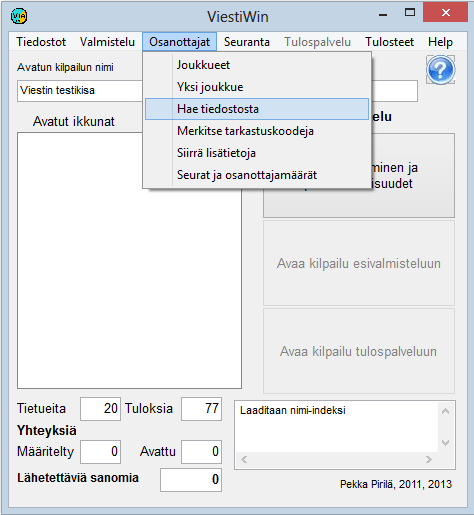

# 1.3.3 Menu: Entries

The main menu option *Entries* starts functions related
to entrants, most of which can be used both in preparation and in
results service mode.

- **Teams.**
  A table for viewing and editing entrant data. From the table
  you can click further to the data form of an individual
  team, which is also used to enter new
  teams.

  - **Show competitors on course.** A table,
    by leg, of competitors who have an Emit number and a recorded
    start time but no finish time on that leg, and who have not been
    marked as absent, did not start, vacant, did not finish
    or disqualified. A closed earlier leg is not enough without a start time.
    The columns are start location, start time and all
    split points in use. The list can be filtered by class. The button *Fetch*
    refreshes the display.

  - **One team.** A direct link to the data form of a single
    team.

    - **Get from file.**
      Reads entrant data from text files, such as data produced by the
      orienteering IRMA system and the skiing KILMO system, as well as
      transfer files produced by the program itself. Reading is also possible
      from a MySQL database and from some file formats produced by
      earlier programs.- **Mark check codes.** Used e.g. to mark competitors who did not show up
        as did not start.- **Transfer additional data.** Many different
          ways to move competitor data from one field to another, either without a controlling
          file or according to tabular data in a text file.
          Used e.g. to transfer ranking points to competitors for the
          draw.

          - **Clubs and entry counts.** Tables showing the
            number of entrants in each class and the number of participants from each club. Also
            printing of the club list.
