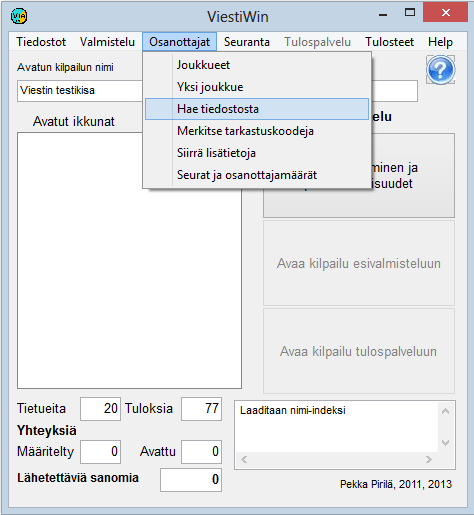

# 1.3.3 Menyval: Deltagare

Huvudmenyns val *Deltagare* startar funktioner som gäller
deltagarna och som i huvudsak kan användas både vid förberedelserna och i
resultattjänstläget.

- **Lag.**
  Tabell för att granska och redigera deltagaruppgifter. Från tabellen
  kommer du genom att klicka vidare till formuläret för ett enskilt lags
  uppgifter, där även nya
  lag matas in.

  - **Visa tävlande i terrängen.** Tabell
    sträckvis över tävlande som har ett emit-nummer och en registrerad
    starttid men ingen måltid på sträckan i fråga, och som inte har
    markerats som frånvarande, ej startade, vakanta, utgått
    eller diskvalificerade. En stängd tidigare sträcka räcker inte utan starttid.
    Kolumnerna är startplats, starttid och alla mellantidspunkter
    som används. Listan kan begränsas per klass. Knappen *Hämta*
    uppdaterar visningen.

  - **Ett lag.** Direkt länk till formuläret för ett
    lags uppgifter.

    - **Hämta från fil.**
      Läser in deltagaruppgifter från textfiler, såsom data från orienteringens
      IRMA-system och skidåkningens KILMO-system samt
      överföringsfiler som programmet själv har skapat. Hämtning är också möjlig
      från en MySQL-databas samt från vissa filformat som
      tidigare program har skapat.- **Markera kontrollkoder.** Används bland annat för att markera ej startat för
        tävlande som uteblivit.- **Flytta tilläggsdata.** Många olika
          sätt att flytta tävlandes uppgifter från ett fält till ett annat, antingen utan styrande
          fil eller enligt tabelldata i en textfil.
          Används bland annat för att flytta rankingpoäng till de tävlande inför lottningen.

          - **Klubbar och deltagarantal.** Tabeller som visar klassernas
            deltagarantal och antalet deltagare från varje klubb. Även
            utskrift av klubblistan.
