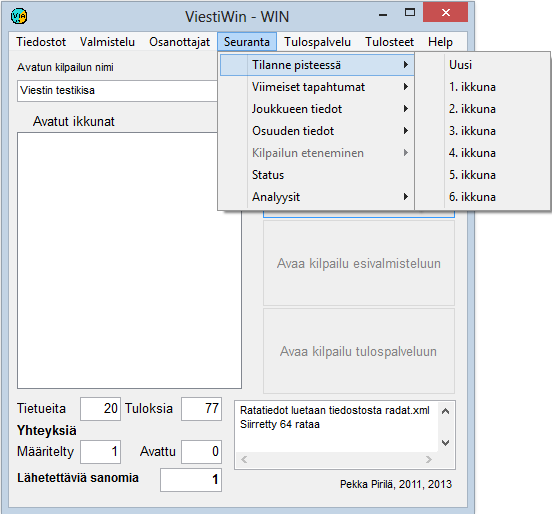

# 1.3.4 Menu: Monitoring

Through the menu *Monitoring* you can open many
different monitoring windows that are suitable, among other things, for the announcer. Several copies
of many window types can be opened, so that you can follow
the situation in several classes or of several competitors. From many windows you can
also proceed to forms showing more details by clicking the related
buttons or table rows.

- **Standings at point.** Leads to a tabular
  form that shows the situation of a selected class at a selected
  point.

  - **Latest events.** Brings up
    a table showing the most recent new data either overall or at a selected
    point.

    - **Team data.**
      Shows the data of
      a team. (The same form as through the Entries menu, but with
      editing disabled.

      - **Leg data.** Shows, among other things, the data of an individual competitor and
        split times calculated from Emit punches.

        - **Status.** Information
          on the numbers of results and disqualifications in the various classes, on data transfer connections and
          on the state of automatic output.- **Analyses
            / Emit analyses.** Comparison of competitors' Emit split times.
            (Temporarily
            disabled)

            - **Analyses / Summary.** Tabular data on Emit split times. (Temporarily
              disabled)
