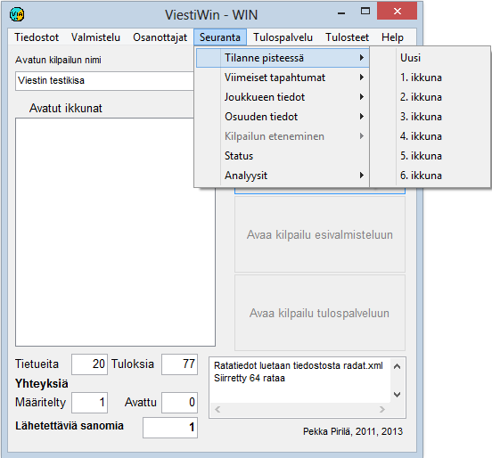

# 1.3.4 Menyval: Uppföljning

Via valet *Uppföljning* kan du öppna många
olika uppföljningsfönster som lämpar sig bland annat för speakern. Av många
fönstertyper kan flera kopior öppnas, så att det är möjligt att följa
ställningen i flera klasser eller för flera tävlande. Från många fönster kan du
också gå vidare till formulär med fler detaljer genom att klicka på
tillhörande knappar eller tabellrader.

- **Ställning vid punkt.** Leder till ett tabellformat
  formulär som visar ställningen i en vald klass vid en vald
  punkt.

  - **Senaste händelser.** Visar
    en tabell med de senaste nya uppgifterna, antingen totalt eller vid en vald
    punkt.

    - **Lagets data.**
      Visar uppgifterna om
      laget. (Samma formulär som via deltagarvalet, men utan möjlighet till
      redigering.

      - **Sträckans data.** Visar bland annat en enskild tävlandes uppgifter och
        bland annat mellantider beräknade från emit-stämplingarna.

        - **Status.** Uppgifter
          om antalet resultat och diskvalificerade i olika klasser, om dataöverföringsförbindelser samt
          om läget för den automatiska utskriften.- **Analyser
            / Emit-analyser.** Jämförelse av tävlandes emit-mellantider.
            (Tillfälligt
            ur bruk)

            - **Analyser / Sammandrag.** Tabelldata om emit-mellantider. (Tillfälligt
              ur bruk)
