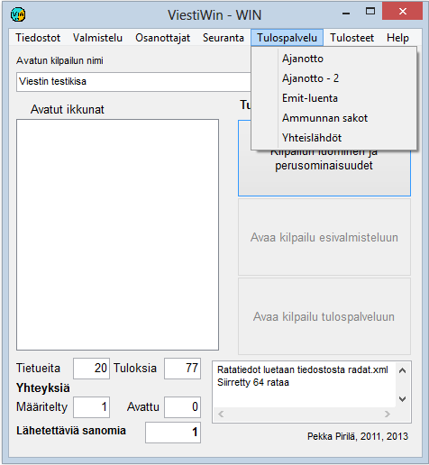

# 1.3.5 Menu: Results service

The menu *Results service* leads to the timing
and punch checking functions. From this menu you can also calculate
points based on results at the end of the competition, and change
start times by class if the competition schedule has changed.

**

- **Timing, Timing - 2.** A form for monitoring timing. Makes it possible
  to follow two different timing tables. (Not yet
  implemented)

  - **Emit reading.** Emit punch checking,
    which can also include results calculation.

    - **Card readout (emit)**. This option
      is available when the program has been started with the parameter SISÄÄNLUENTA.
      It leads to the Emit code recording function, which is
      used as competitors move to the start or changeover area.

      - **Mass starts.** Definitions concerning mass
        starts.- **Shooting penalties.**
          Here you can enter the number of misses and follow
          data on misses received from the Kuronen
          equipment.

The options visible at any given time vary according to
the sport and the startup parameters.
