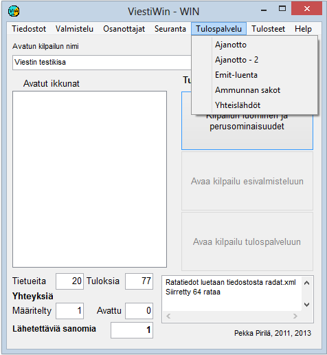

# 1.3.5 Menyval: Resultattjänst

Från valet *Resultattjänst* kommer du till funktionerna för tidtagning
och stämplingskontroll. Från det här valet kommer du också till poängberäkning
utifrån resultaten i tävlingens slutskede samt till att ändra
starttider klassvis, om tävlingens tidsschema har ändrats.

**

- **Tidtagning, Tidtagning - 2.** Formulär för att följa tidtagningen. Möjlighet att
  följa två olika tidtagningstabeller. (Ännu inte
  genomfört)

  - **Emit-avläsning.** Emit-stämplingskontroll,
    som också kan omfatta resultatberäkning.

    - **Inläsning (emit)**. Det här valet
      är tillgängligt när programmet har startats med parametern SISÄÄNLUENTA.
      Via valet kommer du till funktionen för registrering av Emit-koder, som
      används när de tävlande går in i start- eller växlingsområdet.

      - **Masstarter.** Definitioner som gäller
        masstarter.- **Skyttestraff.**
          I det här valet kan du mata in antalet bom samt följa
          uppgifter om bom som fåtts från Kuronens
          utrustning.

Vilka alternativ som visas varierar
beroende på gren och startparametrar.
