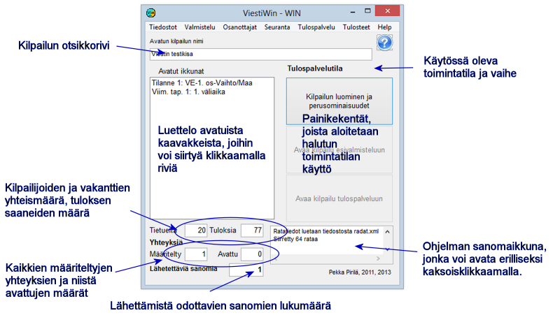

# 1.3 The main form

The menus of the program's main form give direct access to most
functions. In addition, there are a few functions that are reached through forms
opened from here. The following pages briefly present the uses of the
menu options.

The function *Competition creation and
basic properties* can be reached
both directly after the program has started and from either of the other operating modes.
You cannot move between preparation and results service mode, or from one stage to another,
without exiting the whole program in between.

The data at the bottom of the form, showing the number of connections and the number of messages
waiting to be sent, tell the state of data transfer. A growing number of messages
to be sent indicates that one of the defined connections is not working.
