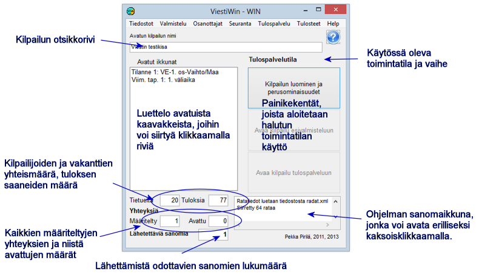

# 1.3 Programmets huvudformulär

Från menyerna i programmets huvudformulär kommer du direkt till de flesta
funktioner. Dessutom finns några funktioner som nås via formulär som öppnas
härifrån. På följande sidor presenteras kort vad menyalternativen
används till.

Till funktionen *Skapa tävling och
grundegenskaper* kan du gå
både direkt efter att programmet har startat och från vart och ett av de andra driftlägena.
Mellan förberedelseläget och resultattjänstläget eller från en etapp till en annan kan du inte byta
utan att däremellan avsluta hela programmet.

Uppgifterna längst ned i formuläret om antalet förbindelser och antalet meddelanden
som väntar på att skickas visar dataöverföringens status. Om antalet meddelanden
som ska skickas växer, betyder det att någon av de definierade förbindelserna inte fungerar.
