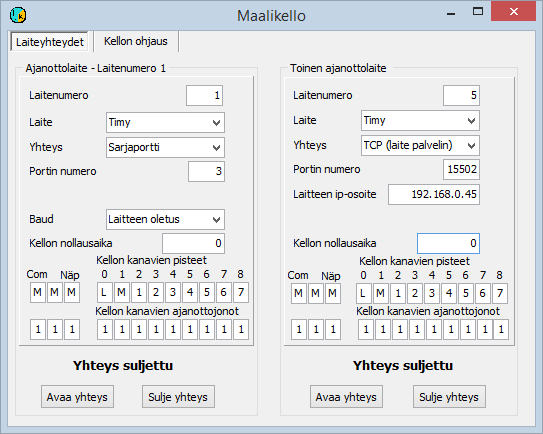

# 5.2  Using a finish clock

### 5.2  Using a finish clock

The use of finish clocks should usually be prepared
in advance and the selections saved in the configuration file. Especially
during testing and when the situation changes during the competition it may, however, be
more practical to change the selections through the menu. This is discussed below
in section 5.2.2.

#### 5.2.1 Finish clocks and enabling them with the configuration file

The programs support several clock models. These include

- Timy, S3, S4 and Comet manufactured by Alge-Timing.

  - Emit's (formerly Regnly) RTR1, RTR2, ECB1 and ETS1.

In addition, the software includes support for some rarer devices,
which has not, however, been continuously maintained.

Finish clocks are mostly used only for taking the time, so that the information on
the competitor is entered by hand or in some cases obtained from a chip either
through the finish clock or a separate device. Other subchapters discuss
procedures in which identification is part of the same event as
the timing.

The program stores times in units of 1/10000 s, but the last decimal usually
does not contain actual timing information. It can then help by keeping times
in a fixed order even when they are identical to the millisecond.

The finish clock is usually connected to the program through a serial port, but Timy can
also be connected by combining USB and TCP connections, as described in appendix 7.
Nowadays the computer's serial port is often implemented with a USB/RS232
converter. Some devices may contain such a converter, in which case
the cable used is a USB cable, but from the program's point of view the connection is still
a serial port. The finish clock type and the serial port number are given with
a configuration parameter, which can be for example

TIMY= 7

when the clock is a Timy and the serial port provided by the USB converter is COM7.

**Determining the target point of timing**

1. The basic default is that all times concern changeovers and the finish

   - The default for all times can be changed
     with the parameter PISTE

     - The point can be determined by the timing input of the finish clock
       with the parameter PISTEET

       - When times are directed to several queues, a default point can be defined
         for each queue with the parameter JONOPISTE

         - The point can be left to be deduced from the competitor's earlier times,
           either in all cases or in cases more closely delimited by the parameters mentioned above.

**Defining the point for all times**

For example, the parameter

PISTE=1

tells that all times
come from the first split point of the leg. In place of the number 1 the following characters can be used

A = the point is determined
later  
L = start (rare when using the relay
program, but sometimes used)  
M = finish or
changeover  
1, 2, .., 9 =
the split point of the leg given by the numeric value

**Determining the point according to the finish clock
input**

Most finish clocks can report information about the timing
point. The interpretation of this information is controlled with a parameter of the form

PISTEET=AMMLM123

The letters and digits of the string following the equals sign
relate, in order, to the following timing methods

- Button connected to the serial port

  - Reserved (earlier use discontinued)

    - Computer keyboard key

      - Finish clock start input or button

        - Finish clock finish input or button

          - Finish clock 1st split input

            - Finish clock 2nd split input

              - ..

The characters of the string produce the same character on the computer
display, thus indicating whether the input is open and to be interpreted or tied
to a specific point. If the sequence number of a split point is 10 or greater,
each character must be separated from the others by a comma. The string must thus have a comma right
after the first identifying character.

**Using timing queues**

Times can be directed to several different queues using the parameter

JONOT=1112134

which works like the parameter PISTEET, but now directs to different queues. The combination of the
parameters mentioned above directs start times to queue 2, finish times to queue
1 and split times to queues 3 and 4.

A timing point or the method of determining
the point can be defined for different queues with the parameter JONOPISTE. For example

JONOPISTE2=A

tells that for times stored in the second queue
the point is determined later. Each queue can thus be
given a different
purpose.

**Automatic determination of the point**

When the point is not determined directly as described above
but has been left to be determined later, automatic determination
of the point as the point next in turn based on earlier results is usually in use.
The leg is determined as the first one that does not yet have a finish time, and the point
as the point following the most recent earlier time
taken.

If the program has been given
the parameter

VAINVÄLIAJAT

the program does not give a finish or changeover time once the split times are filled,
but marks the point as the value following the number of split points.
In this case the time is not recorded for the competitor, but it is shown
in the timing data.

#### 5.2.2 Finish clock selections on the settings forms

(The image is from HkKisaWin. ViestiWin does not support two
timing devices)

This form does not show data concerning Emit devices,
which have a form of their own ([chapter 6.6](6.10_mtr-_ja_emitag-laitteiden_ohjaus.md)
).

This section deals with finish clocks whose operation is not
based on detecting a chip. The selections for Emit's ECB1 and ETS1 are made
on the Emit device settings forms.

The following description applies largely both to the form opened through the timing form's
menu and to the corresponding selections in the [configuration editor](1.3_toimintatilojen_konfigurointi.md)
.

Finish clocks operate as device no 1. No other
device can be device 1 at the same time. Defining the device starts
by selecting the finish clock type.

The normal way to connect all clocks to the program is
a serial port, but Timy can also be connected to the computer directly
over a USB connection that is not based on a serial port adapter. In that case Timy is
connected to a separate program, which sends the data to the results program
using the TCP protocol, acting as a TCP server. My emulator programs that work like
a finish clock can also send data over a TCP
connection. For these uses there is an option to select TCP as the connection
type.

When a serial port is used, the serial port number is also defined.
The data rate is usually the device default, in the case of Timy 9600 baud, which must
be selected through Timy's menus if it is not already selected. It is,
however, also possible to choose that the program uses a different serial port
speed.

When a TCP connection is used, the clock or the external
computer program normally acts as the server, in which case the device's IP address and
connection port must be given in the HkKisaWin
settings.

The definitions also include the option to define
a clock time offset if the finish clock gives times that differ from local time.
The offset is expressed as the time of day at which the finish clock time was or would have been
00:00:00.

On the form you can also define which point's times
the different channels of the finish clock and the other timing methods give, and to which
timing queue these times are directed.
