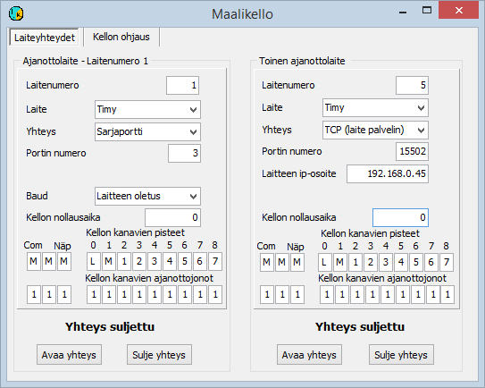

# 5.2  Använda målklocka

### 5.2  Använda målklocka

Användningen av målklockor bör i allmänhet förberedas
i förväg och valen sparas i konfigurationsfilen. Särskilt
i testskedet och när situationen ändras under tävlingen kan det dock vara
mer praktiskt att ändra valen via menyn. Detta behandlas nedan
i avsnitt 5.2.2.

#### 5.2.1 Målklockor och hur de tas i bruk med konfigurationsfilen

Programmen stöder flera målklockmodeller. Dessa är

- Timy, S3, S4 och Comet tillverkade av Alge-Timing.

  - Emits (tidigare Regnly) RTR1, RTR2, ECB1 och ETS1.

Dessutom har stöd för mer sällsynta enheter också genomförts i programvaran,
men det har inte underhållits kontinuerligt.

Målklockor används till största delen bara för att ta tiden, så att uppgiften
om den tävlande matas in manuellt eller i vissa fall fås från en bricka, antingen
via målklockan eller via en separat enhet. I andra underkapitel behandlas
förfaranden där identifieringen är en del av samma händelse som
tidtagningen.

Programmet sparar tiderna i enheter om 1/10000 s, men den sista decimalen
innehåller i allmänhet ingen verklig tidtagningsinformation. Den kan då hjälpa till att hålla tiderna
i en fast ordning, även om de är lika på millisekunden.

Målklockan ansluts till programmet i allmänhet via en serieport, men Timy kan
också anslutas genom att kombinera USB- och TCP-förbindelser, så som beskrivs i bilaga 7.
Datorns serieport är numera ofta förverkligad med en USB/RS232-omvandlare.
Vissa enheter kan innehålla en sådan omvandlare, och då är
kabeln som används en USB-kabel, men anslutningen är ändå en serieport
ur programmets synvinkel. Målklockans typ och serieportens nummer anges
med en konfigurationsparameter, som till exempel kan vara

TIMY= 7

när klockan är en Timy och serieporten som USB-omvandlaren tillhandahåller är COM7.

**Hur tidtagningens målpunkt bestäms**

1. Grundantagandet är att alla tider gäller växlingar och mål

   - Standardvärdet för alla tider kan ändras
     med parametern PISTE

     - Punkten kan bestämmas utifrån målklockans
       tidtagningsanslutning med parametern PISTEET

       - När tiderna styrs till flera köer kan en
         standardpunkt definieras för varje kö med parametern JONOPISTE

         - Punkten kan lämnas att härledas från de tider som den tävlande tidigare fått,
           antingen i alla fall eller i fall som närmare avgränsas av de ovan nämnda parametrarna.

**Definiera punkten för alla tider**

Till exempel parametern

PISTE=1

anger att alla tider
kommer från sträckans första mellantidspunkt. I stället för siffran 1 kan följande tecken stå

A = punkten bestäms
senare  
L = start (ovanligt när stafettprogrammet
används, men förekommer ibland)  
M = mål eller
växling  
1, 2, .., 9 =
sträckans mellantidspunkt enligt siffervärdet

**Bestämma punkten enligt målklockans
anslutning**

De flesta målklockor kan ange uppgifter om
tidtagningspunkten. Tolkningen av denna uppgift styrs med en parameter av formen

PISTEET=AMMLM123

Bokstäverna och siffrorna i teckensträngen efter likhetstecknet
hör i tur och ordning till följande tidtagningssätt

- Knapp ansluten till serieporten

  - Reserv (tidigare användning har upphört)

    - Knapp på datorns tangentbord

      - Målklockans startportsanslutning eller knapp

        - Målklockans målanslutning eller knapp

          - Målklockans 1:a mellantidsanslutning

            - Målklockans 2:a mellantidsanslutning

              - ..

Tecknen i teckensträngen ger samma tecken på datorns
skärm och visar därmed om användningen är öppen och ska tolkas eller är bunden
till en viss punkt. Om mellantidspunktens ordningsnummer är 10 eller större måste
varje tecken skiljas från de andra med kommatecken. Teckensträngen måste alltså ha ett kommatecken direkt
efter det första tecknet.

**Använda tidtagningsköer**

Tiderna kan styras till flera olika köer med parametern

JONOT=1112134

som styr på samma sätt som parametern PISTEET, men nu till olika köer. En kombination
av de ovan nämnda parametrarna styr starttiderna till kö 2, måltiderna till kö
1 och mellantiderna till köerna 3 och 4.

För olika köer kan en tidtagningspunkt eller
ett sätt att bestämma punkten definieras med parametern JONOPISTE. Till exempel

JONOPISTE2=A

anger att för tider som sparas i den andra kön
bestäms punkten senare. Varje kö kan alltså
ges ett eget
användningsområde.

**Automatisk bestämning av punkten**

När punkten inte bestäms direkt på det sätt som beskrivs ovan,
utan har lämnats att bestämmas senare, används i allmänhet automatisk
bestämning av punkten utifrån tidigare resultat som den punkt som
står i tur. Sträckan bestäms som den första som ännu saknar sluttid, och punkten
som den punkt som följer efter den senast tagna tiden.

Om programmet har fått
parametern

VAINVÄLIAJAT

ger programmet inte någon mål- eller växlingstid när mellantiderna är fyllda,
utan sätter som punkt värdet som följer efter antalet mellantidspunkter.
Då registreras tiden inte för den tävlande, men den syns
i tidtagningsuppgifterna.

#### 5.2.2 Val för målklockan i definitionsformulären

(Bilden är från programmet HkKisaWin. ViestiWin stöder inte två
tidtagningsenheter)

I det här formuläret visas inga uppgifter om Emit-enheter;
de har ett eget formulär ([kapitel 6.6](6.10_mtr-_ja_emitag-laitteiden_ohjaus.md)
).

Här behandlas målklockor vars funktion inte
bygger på att en bricka detekteras. Valen för Emits ECB1 och ETS1 görs
i definitionsformulären för Emit-enheter.

Följande beskrivning gäller till största delen både det formulär som öppnas via
tidtagningsformulärets meny och motsvarande val i [konfigurationsredigeraren](1.3_toimintatilojen_konfigurointi.md).

Målklockor fungerar som enhet nr 1. Samtidigt kan ingen
annan enhet vara enhet 1. Definitionen av enheten börjar
med att välja målklockans typ.

Det normala sättet att ansluta alla klockor till programmet är
serieporten, men Timy kan också anslutas till datorn direkt
med en USB-förbindelse som inte bygger på en serieportsadapter. Då är Timy
ansluten till ett separat program, som skickar uppgifterna till resultatprogrammet
med TCP-protokollet och fungerar som TCP-server. Även mina emulatorprogram, som
fungerar som en målklocka, kan skicka uppgifter via en TCP-förbindelse.
För dessa användningssätt finns möjligheten att välja TCP som
förbindelseform.

När serieporten används anges vidare serieportens nummer.
Överföringshastigheten är i allmänhet enhetens standardvärde, för Timy 9600 baud, vilket
måste väljas via Timys menyer om det inte redan är valt. Det är
dock också möjligt att välja att programmet använder en avvikande
serieportshastighet.

När en TCP-förbindelse används fungerar klockan eller det externa
datorprogrammet normalt som server, och då måste enhetens IP-adress och anslutningsport anges i
programmet HkKisaWins definitioner.

Definitionerna omfattar dessutom en möjlighet att ange
en klockslagsavvikelse, om målklockan ger tider som avviker från lokal tid.
Avvikelsen anges som det klockslag då målklockans tid var eller skulle ha varit
00:00:00.

I formuläret kan du också definiera vilken punkts tider
målklockans olika kanaler och andra tidtagningssätt ger och till vilken
tidtagningskö dessa tider styrs.
