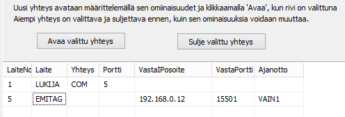

# 6.6 Connections to the Emit reader, controlling MTR and emiTag devices

### 6.6 Connections to the Emit reader, controlling MTR and emiTag devices

When an MTR device or an emiTag system device is in use, you can
select control of that device as a function from the menu of the punch checking form and the timing form.
The form that opens lets you request data to be sent
from the device's memory, set the device clock to the same time as the computer
and give device-specific control commands. The meaning of the commands used
is explained in the documentation of the device concerned.

The use of emiTag devices is discussed in more detail in [appendix 5](liite_5._emitag-laitteiden_kaytto.md) .

MTR and emiTag devices store the data they read
in their memory. The program can retrieve these data afterwards, either directly
for handling or into a separate file. When data are retrieved
into a separate file, you can select in the punch checking form option *Read data from file* which of the data are taken
into actual handling.

Connections to Emit devices are usually defined in advance
using the configuration file, but a connection to a device can also be opened
and closed through the HkKisaWin menu. This is suitable for unforeseen
special needs, for testing and for changing the connection used, for example
in a situation where a serial port converter stops working in the original
USB port but can be made to work through another USB port.

The Emit device connection is defined in a very similar way both in the [configuration editor](1.3_toimintatilojen_konfigurointi.md)
and, during use, on the form opened through the punch checking form's
menu.

In the connection table of the form, the first
column contains the device number, whose maximum value may vary and is currently 32.
The device number must not be the same as that of another device. A finish clock therefore
cannot use the same number as a reader device.

The other data are partly selected by clicking the
cell concerned with the right mouse button.

- In column 2 you can select reader,
  emiTag device or MTR (MTR5 works as an emiTag device).

  - In column 3 select either serial port or
    IP connection, for which there are three options.

    - In column 4 enter the computer's serial port
      for a serial port connection, and the IP port when the device's own IP port must
      be given

      - In column 5 enter the device's IP address if
        the program must connect to a device acting as a server

        - In column 6 enter the port belonging to the IP address
          in column 5.

          - In column 7 select, with the mouse,
            any timing options.

In the area above, the upper row has been set to
a typical connection to an Emit reader. The lower row indicates that the connection
to an emiTag device is made using the TCP protocol. The program requests a connection
from the address 192.168.0.12:15501. This connection is used for timing so that
the times go to the first split time. (These two rows do not work without problems
together.)
