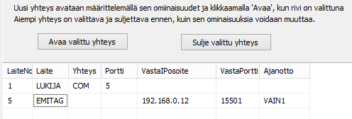

# 6.6 Förbindelser till Emit-läsaren, styrning av MTR- och emiTag-enheter

### 6.6 Förbindelser till Emit-läsaren, styrning av MTR- och emiTag-enheter

När en MTR-enhet eller en enhet i emiTag-systemet används kan du
i stämplingskontrollformulärets och tidtagningsformulärets meny välja styrning av den aktuella enheten
som funktion. I formuläret som då öppnas kan du begära att uppgifter skickas
från enhetens minne, ställa enhetens klocka till samma tid som datorns
samt ge enhetsspecifika styrkommandon. Betydelsen av de kommandon som används
framgår av dokumentationen för enheten i fråga.

Användningen av emiTag-enheter behandlas närmare i [bilaga 5](liite_5._emitag-laitteiden_kaytto.md) .

MTR- och emiTag-enheter sparar lästa uppgifter
i sitt minne. Programmet kan i efterhand hämta dessa uppgifter antingen direkt
för behandling eller läsa dem till en separat fil. När uppgifterna hämtas
till en separat fil kan du i stämplingskontrollformulärets val *Läs uppgifter från fil* välja vilka av uppgifterna som tas
till egentlig behandling.

Förbindelserna till Emit-enheter definieras i allmänhet i förväg
med konfigurationsfilen, men det är också möjligt att öppna
och stänga förbindelsen till enheten via menyn i programmet HkKisaWin. Detta lämpar sig för oförutsedda
specialbehov, testning samt för att byta förbindelse till exempel
i en situation där en serieportsomvandlare slutar fungera i den ursprungliga
USB-porten, men kan fås att fungera via en annan USB-port.

Emit-enhetens förbindelse definieras på mycket likartat sätt både i [konfigurationsredigeraren](1.3_toimintatilojen_konfigurointi.md)
och under drift i det formulär som öppnas via stämplingskontrollformulärets
meny.

I formulärets förbindelsetabell anges i den första
kolumnen enhetens nummer, vars maximivärde kan variera och nu är 32.
Enhetens nummer får inte vara detsamma som för en annan enhet. Målklockan kan alltså inte
använda samma nummer som en läsarenhet.

Övriga uppgifter väljs delvis genom att klicka på respektive
ruta med höger musknapp.

- I kolumn 2 kan du välja läsare,
  emiTag-enhet eller MTR (MTR5 fungerar som emiTag-enhet).

  - I kolumn 3 väljer du antingen serieport eller
    IP-förbindelse, för vilken det finns tre alternativ.

    - I kolumn 4 skriver du datorns serieport
      vid en serieportsförbindelse och ip-porten när enhetens egen ip-port måste
      anges

      - I kolumn 5 skriver du enhetens ip-adress, om
        programmet ska ta kontakt med en enhet som fungerar som server

        - I kolumn 6 skriver du den port som hör till ip-adressen i kolumn 5.

          - I kolumn 7 väljer du med musen
            eventuella val för tidtagningsfunktionen.

I området ovan har på den övre raden en
typisk förbindelse till en Emit-läsare valts. Den nedre raden anger att förbindelsen
till emiTag-enheten upprättas med TCP-protokollet. Programmet begär förbindelse
från adressen 192.168.0.12:15501. Den här förbindelsen används för tidtagning så att
tiderna går till den första mellantiden. (Dessa två rader fungerar inte problemfritt
tillsammans.)
